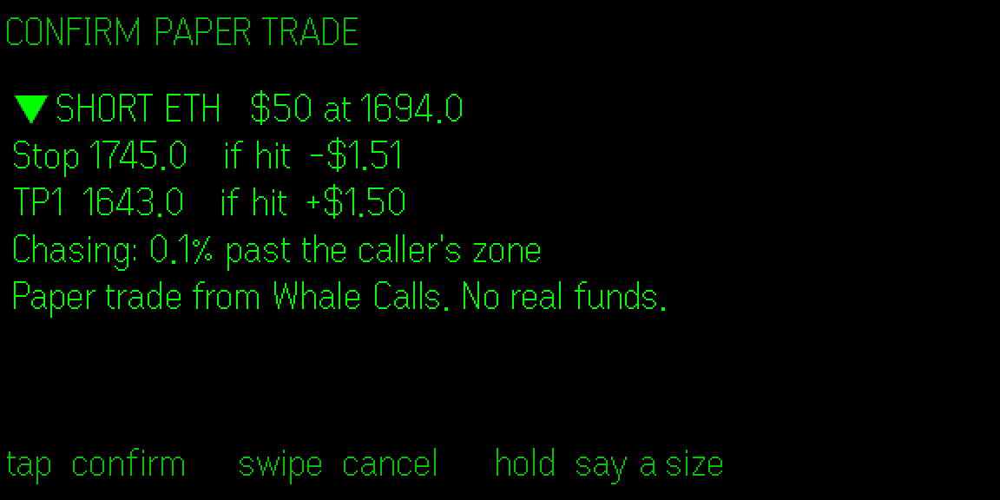
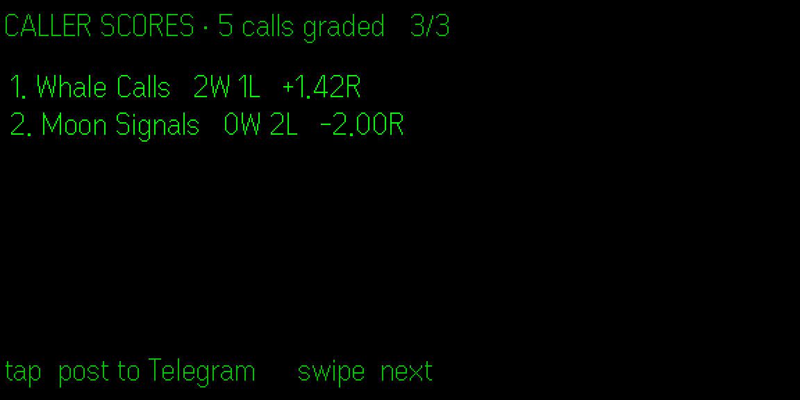

# CalledIt

**Telegram trade calls on Even Realities G2 glasses, graded against the market.**

Crypto Telegram channels post calls all day: *LONG SOL, entry 68.2–68.5, SL 65.6, TP 71 / 74*. Most people
either chase them blindly or ignore them, because nobody keeps score. CalledIt reads those calls as they
arrive, shows each one on your glasses as a clean ticket, lets you paper-trade it with one tap or one
spoken word, and grades every call (and every caller) against real Hyperliquid candles in R multiples.

After a week you know which caller is worth listening to. You never risk a cent finding out.

| A new call arrives | Tap to paper it | The position, live | Caller scoreboard |
|---|---|---|---|
|  |  |  |  |

*Simulator screenshots (576×288, monochrome green), prices are live Hyperliquid mainnet data.*

## What it does

- **Reads calls from Telegram.** Add the bot to your call channel (or a group), or forward calls to it.
  A rule-based parser turns free text into a ticket: side, coin, entry zone, stop, targets, leverage. It
  handles `61.2k`, `$PEPE`, ranges, one-liners and emoji, maps memecoins to Hyperliquid's 1000× perps
  (`kPEPE`, `kBONK`) and refuses to guess: anything it cannot read cleanly, or that fails a sanity check
  (long with the stop above entry, entry 3× away from the market), is skipped and you are told why.
- **Shows one card at a time on the G2.** New call, confirm, open position, scoreboard. Every card's
  footer says exactly what tap, hold and swipe will do right now.
- **Paper trades with one tap or one word.** Tap to stage a trade at your default size, tap again to
  confirm. The confirm card shows the dollar risk to the caller's stop and the dollar gain at TP1,
  and warns when price has already run past the caller's entry zone. A trade whose stop or TP1 has
  already been hit is refused. Positions close themselves at SL or TP.
- **Push-to-talk.** Hold the touchpad and say *"paper fifty"*, *"skip"*, *"close it"* or *"make it one
  hundred"*. Speech-to-text runs locally (Whisper tiny.en via transformers.js), no API key, no cloud.
- **Grades every call.** Forward a caller's old calls and each one is replayed on Hyperliquid candles
  from the moment it was posted: did it fill, and did TP1 or the stop come first? Results are in R
  (multiples of the risk the caller set), summed per caller into a scoreboard you can post back to
  Telegram from the glasses.
- **Journals to Telegram.** Every paper trade you open or close on the glasses is logged in your
  private chat with the bot, so the record outlives the session.

## Why it is safe

CalledIt never touches real money. It holds no exchange keys, signs nothing and places no orders.
Hyperliquid is used read-only (prices and candles from the public info API). Paper size is capped
($250 by default). The only secret is your Telegram bot token, and it lives on your server, never in
the glasses app.

## Grading rules (conservative on purpose)

- A call fills like a limit order inside its entry zone within **48 h** of being posted; otherwise it
  expires ungraded. A long fills at the lower of the candle open and the top of the zone.
- After the fill, the first level touched decides: **TP1 = win, stop = loss**. If one candle spans
  both, it counts as a **loss**.
- Only candles after the post time are used. No hindsight.
- Score per caller: wins, losses, open, total R, average R, win rate.

## Controls

| Card | Tap | Swipe | Hold |
|---|---|---|---|
| New call | paper it at your default size | next card | speak a size or "skip" |
| Confirm | confirm | cancel | say a different size |
| Position | close | next card | speak |
| Scores | post the scoreboard to Telegram | next card | |

Double-tap exits (system dialog). Telegram commands: `/score` for the scoreboard, `/size 100` to set
the default paper size.

## How it is built

```
Telegram (bot in your channels, or forwards) ─┐
                                              ├─> CalledIt server ──> /api/view (long-poll) ──> G2 app
Hyperliquid info API (read-only) ─────────────┘          ^
                                                         └── /api/input, /api/voice <── G2 app
```

- `app/`: the Even Hub web app (Vite + TypeScript + `@evenrealities/even_hub_sdk`). A thin client: three
  stacked text containers (dim header, body, dim footer), redrawn only when their text changes. Taps,
  swipes and long-press go to the server; the G2 microphone streams PCM while you hold.
- `server/`: Node 20+, no database, state in one JSON file.
  - `parse.js` reads calls, `grade.js` replays them on candles, `paper.js` is the paper book,
    `engine.js` is the state machine behind the cards, `views.js` writes the card text,
    `intent.js` turns a transcript into an action, `stt.js` runs Whisper locally,
    `telegram.js` long-polls the Bot API.
- Tests: `cd server && npm test` (37 tests: parser, grading, paper book, voice intents end to end
  through Whisper, and the engine with a fake market).

## Run it

Requirements: Node 20+, the Even Hub simulator (`npm i -g @evenrealities/evenhub-simulator`) or a G2.

```bash
# 1. server
cd server
npm install
npm run fetch-model            # downloads Whisper tiny.en (~43 MB) once, into server/models
cp .env.example .env           # put your BotFather token in TELEGRAM_BOT_TOKEN
npm start                      # http://127.0.0.1:8787

# 2. glasses app
cd ../app
npm install
npm run dev                    # http://127.0.0.1:5173
npm run simulate               # opens the Even Hub simulator on the app
```

Then send `/start` to your bot (this links your journal chat) and add the bot as an admin to a call
channel, or forward a few calls to it.

To try it without Telegram, start the server with `npm run demo` (dev endpoints on) and post a call to
the dev endpoint:

```bash
curl -X POST http://127.0.0.1:8787/api/dev/message -H 'content-type: application/json' \
  -d '{"text":"LONG $SOL entry 68.2-68.5 SL 65.6 TP1 71.07 TP2 73.8","source":"Alpha Desk"}'
```

On a phone, run the server on your LAN (`HOST=0.0.0.0`), open the app with `?api=http://<server-ip>:8787`
and add that address to the `network` whitelist in `app/app.json`. `npx evenhub pack app.json dist`
builds the `.ehpk`.

## Limits

- The parser covers the common English call formats; unusual layouts are skipped rather than guessed.
- Grading uses 1-minute candles for calls up to about 3 days old, 15-minute candles up to 50 days and
  hourly candles up to 200 days (Hyperliquid returns at most 5,000 candles per request); older calls are
  not graded. A wick inside one candle can hide which level came first; that case is scored as a loss.
- Built and tested on the Even Hub simulator; no G2 hardware was available.

## License

MIT
