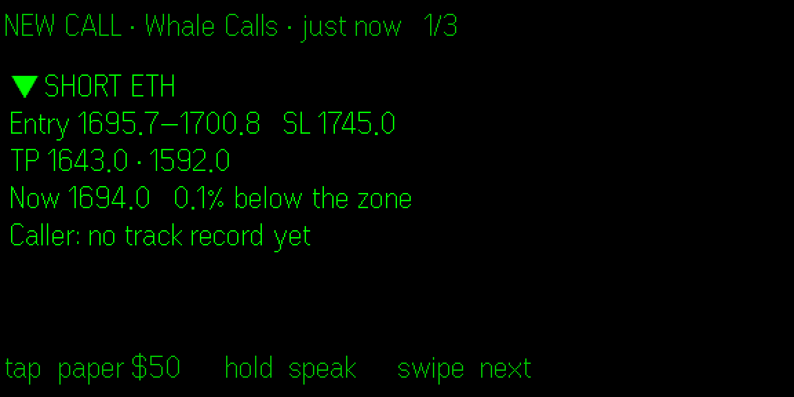
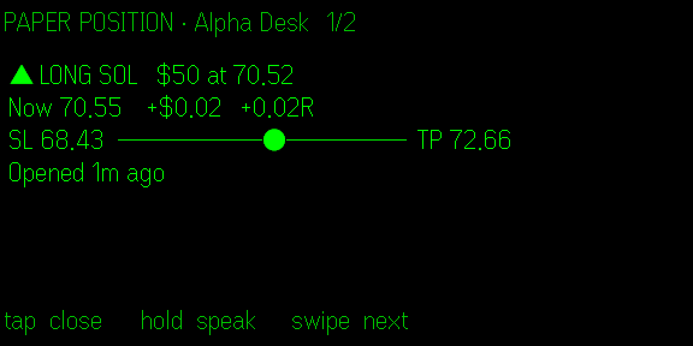

# CalledIt

**Telegram trade calls on Even Realities G2 glasses: take one on Binance demo with a tap, and see which callers are worth following.**

Crypto Telegram channels post calls all day: *LONG SOL, entry 68.2-68.5, SL 65.6, TP 71 / 74*. Most people
either chase them blindly or ignore them, because nobody keeps score. CalledIt reads those calls as they
arrive and shows each one on your glasses as a clean ticket, with the caller's track record on the second
line. One tap, or one spoken word, places it on your Binance Futures demo account, with the caller's stop
and first target set as orders that Binance holds. Every call, and every caller, is graded against
Binance USD-M candles in R multiples.

After a week you know which caller is worth listening to, and you found out with demo funds.

| A new call arrives | Tap to take it | The position, live | Caller scoreboard |
|---|---|---|---|
|  |  |  |  |

*Even Hub simulator screenshots (576×288, monochrome green).*

## Track

Exchanges & Stocks (Binance USD-M futures: live prices and candles from the public API, orders on the
Binance demo exchange), with Messaging & News as the second track (Telegram: bot in channels and groups,
forwarded calls, journal chat). One flow joins them: a call posted in Telegram becomes a Binance demo
order confirmed on the glasses. Also entered for Best Telegram integration.

## What it does

- **Reads calls from Telegram.** Add the bot to your call channel (or a group), or forward calls to it.
  A rule-based parser turns free text into a ticket: side, coin, entry zone, stop, targets, leverage. It
  handles `61.2k`, `$PEPE`, ranges, numbered entries and targets, one-liners and emoji layouts, maps
  memecoins to Binance's 1000× contracts (`1000PEPE`, `1000BONK`), does not mistake words like *order*
  or *take* for the coins Binance lists under those names, and refuses to guess: anything it cannot read
  cleanly, or that fails a sanity check (a long with the stop above entry, an entry 3× away from the
  market), is skipped and you are told why.
- **Shows one card at a time on the G2.** New call, confirm, open position, scoreboard. The call card
  carries the caller's record (*Caller: 15 of 34 hit TP1 first, avg +0.28R*). Every card's footer says
  exactly what tap, hold and swipe will do right now.
- **Takes a call with one tap or one word.** Tap to stage it at your default size, tap again to confirm.
  The confirm card shows the dollars at risk to the caller's stop and the gain at TP1, and warns when
  price has already run past the caller's entry zone. A call whose stop or TP1 has already been hit is
  refused. On confirm, CalledIt sends a market order to the Binance demo exchange, then the stop and TP1
  as close-position orders that Binance holds, so the trade closes at the caller's levels even when the
  server and the glasses are off. If Binance refuses the stop, the position is closed at once. Sizes are
  rounded to Binance's lot step and raised to its minimum order value, and the card says so.
- **Paper mode without a key.** With no Binance demo key, the same taps open paper trades that close
  themselves at the stop or TP1.
- **Push-to-talk.** Hold the touchpad and say *"take fifty"*, *"skip"*, *"close it"* or *"make it one
  hundred"*. Speech-to-text runs locally (Whisper tiny.en via transformers.js), no API key, no cloud.
- **Grades every call.** Forward a caller's old calls and each one is replayed on Binance candles from the
  moment it was posted: did it fill, and did TP1 or the stop come first? Results are in R (multiples of
  the risk the caller set), summed per caller into a scoreboard you can post back to Telegram from the
  glasses.
- **Journals to Telegram.** Every trade you open or close on the glasses is logged in your private chat
  with the bot, with Binance's fill prices, so the record outlives the session.

## Why it is safe

- CalledIt trades only on Binance's demo exchange. The signed client is fixed to `demo-fapi.binance.com`;
  there is no code path to the live exchange's order endpoints.
- The API key and secret live in `server/.env` on your own server. They never reach the glasses app and
  are never logged. Requests are signed with HMAC-SHA256 and timed against Binance's server clock.
- Every position gets a stop that Binance holds. Order size is capped ($250 by default), and new trades
  are refused once the last 24 hours' realized losses reach the daily cap ($25 by default).
- The glasses app holds no keys or tokens: it only talks to your own CalledIt server. The Telegram bot
  token stays on the server too.
- Without a demo key it falls back to paper trades.

## What it found on four public channels

`tools/tg-history.mjs` reads a public channel's history from its web preview, and `tools/grade-history.mjs`
puts every call through the same parser and grader the bot uses. 347 distinct calls from four free
signal channels, posted between May 27 and Nov 26, 2026, graded on Binance USD-M candles on Nov 27
(TP1 against the stop):

| Channel | TP1 first | Stop first | Still open | Win rate | Total |
|---|---|---|---|---|---|
| @cryptosignals0rg | 15 | 19 | 0 | 44% | **+9.69R** |
| @Binance_Futures_Trades | 20 | 4 | 11 | 83% | +2.68R |
| @TradingGainX | 42 | 43 | 0 | 49% | −1.97R |
| @vip_crypto_signal_free | 110 | 37 | 0 | **75%** | **−9.41R** |

The channel that hits its first target 75% of the time lost the most: its targets sit so close that a
win averages +0.25R, while every loss costs the full 1R. @cryptosignals0rg wins less than half the time,
but a win there averages +1.91R. A win rate says nothing without the R.

A call posted again later (result updates that quote the original levels) counts once; 679 such reposts
were dropped. 46 calls never reached their entry within 48 hours, and one candle that touched both the
stop and TP1 was scored as a loss. Four larger "Rose" signal channels (100k+ subscribers each, 700+
posts) could not be graded at all: not one post named a stop loss.

## Grading rules (conservative on purpose)

- A call fills like a limit order inside its entry zone within **48 h** of being posted; otherwise it
  expires ungraded. A long fills at the lower of the candle open and the top of the zone.
- After the fill, the first level touched decides: **TP1 = win, stop = loss**. If one candle spans
  both, it counts as a **loss**.
- Only candles after the post time are used. No hindsight.
- Score per caller: wins, losses, open, total R, average R, win rate.

## Controls

| Card | Tap | Swipe | Hold |
|---|---|---|---|
| New call | take it at your default size | next card | speak a size or "skip" |
| Confirm | place the order | cancel | say a different size |
| Position | close at market | next card | speak |
| Scores | post the scoreboard to Telegram | next card | |

Double-tap exits (system dialog). Telegram commands: `/score` for the scoreboard, `/size 100` to set
the default order size.

## How it is built

```
Telegram (bot in your channels, or forwards) ──┐
Binance USD-M public API (prices, candles) ────┼─> CalledIt server ──> /api/view (long-poll) ──> G2 app
Binance demo API (orders, positions) <─────────┘          ^
                                                          └── /api/input, /api/voice <── G2 app
```

- `app/`: the Even Hub web app (Vite + TypeScript + `@evenrealities/even_hub_sdk`). A thin client: three
  stacked text containers (dim header, body, dim footer), redrawn only when their text changes. Taps,
  swipes and long-press go to the server; the G2 microphone streams PCM while you hold.
- `server/`: Node 20+, no database, state in one JSON file.
  - `parse.js` reads calls, `grade.js` replays them on candles, `binance.js` is the Binance client
    (public market data under a request-weight budget with 429 backoff, and the signed demo client
    synced to Binance's clock), `broker.js` places and watches trades (Binance demo or paper),
    `paper.js` is the trade book, `engine.js` is the state machine behind the cards, `views.js` writes
    the card text, `intent.js` turns a transcript into an action, `stt.js` runs Whisper locally,
    `telegram.js` long-polls the Bot API.
- Tests: `cd server && npm test` (65 tests: the parser on real channel formats, grading, the trade book,
  the demo broker against a fake Binance (fill, stop and TP1 orders, a refused stop, a position closed in
  the Binance app, the daily loss cap), the Binance client (request signing checked against the example
  in Binance's docs, clock offset and resync, candle paging and cache, 429 backoff), voice intents end to
  end through Whisper, and the engine).
- `npm run check-binance` checks the market data and your demo key without placing an order.
- `tools/tg-history.mjs <channel> [days]` pulls a public channel's history (t.me/s web preview), and
  `tools/grade-history.mjs <channel>...` grades it.

## Run it

Requirements: Node 20+, the Even Hub simulator (`npm i -g @evenrealities/evenhub-simulator`) or a G2.

```bash
# 1. server
cd server
npm install
npm run fetch-model            # downloads Whisper tiny.en (~43 MB) once, into server/models
cp .env.example .env           # put your BotFather token in TELEGRAM_BOT_TOKEN
npm start                      # http://127.0.0.1:8787

# 2. glasses app
cd ../app
npm install
npm run dev                    # http://127.0.0.1:5173
npm run simulate               # opens the Even Hub simulator on the app
```

Then send `/start` to your bot (this links your journal chat) and add the bot as an admin to a call
channel, or forward a few calls to it.

To place demo orders, log in at [demo.binance.com](https://demo.binance.com), open API Management,
create a system-generated key, and put it in `BINANCE_API_KEY` and `BINANCE_API_SECRET` in
`server/.env`. `npm run check-binance` confirms the key works. Without a key every tap is a paper trade.

To try it without Telegram, start the server with `npm run demo` (dev endpoints on) and post a call to
the dev endpoint:

```bash
curl -X POST http://127.0.0.1:8787/api/dev/message -H 'content-type: application/json' \
  -d '{"text":"LONG $SOL entry 68.2-68.5 SL 65.6 TP1 71.07 TP2 73.8","source":"Alpha Desk"}'
```

On a phone, run the server on your LAN (`HOST=0.0.0.0`), open the app with `?api=http://<server-ip>:8787`
and add that address to the `network` whitelist in `app/app.json`. `npx evenhub pack app.json dist`
builds the `.ehpk`.

## Built during the hackathon

Everything in this repository was written for Heads Up (from Nov 23, 2026). The first version graded
calls on Hyperliquid and only paper-traded; on Nov 27 it moved to Binance USD-M so that a tap places a
real order on the demo exchange. It uses these existing pieces: the Even Hub SDK, CLI and simulator, the
Telegram Bot API, Binance's USD-M futures REST API (public endpoints and the demo exchange),
`@huggingface/transformers` with the `Xenova/whisper-tiny.en` model, Vite and TypeScript.

## Limits

- The parser covers the common English call formats; unusual layouts are skipped rather than guessed.
- Grading uses 1-minute candles for calls up to 3 days old, 5-minute up to 15 days, 15-minute up to
  45 days and hourly up to 400 days; older calls are not graded. A wick inside one candle can hide which
  level came first; that case is scored as a loss.
- Only the caller's TP1 is placed on Binance; later targets are shown but not traded.
- Demo orders fill on Binance's demo exchange, not on the live order book.
- Built and tested on the Even Hub simulator; no G2 hardware was available.

## License

MIT
